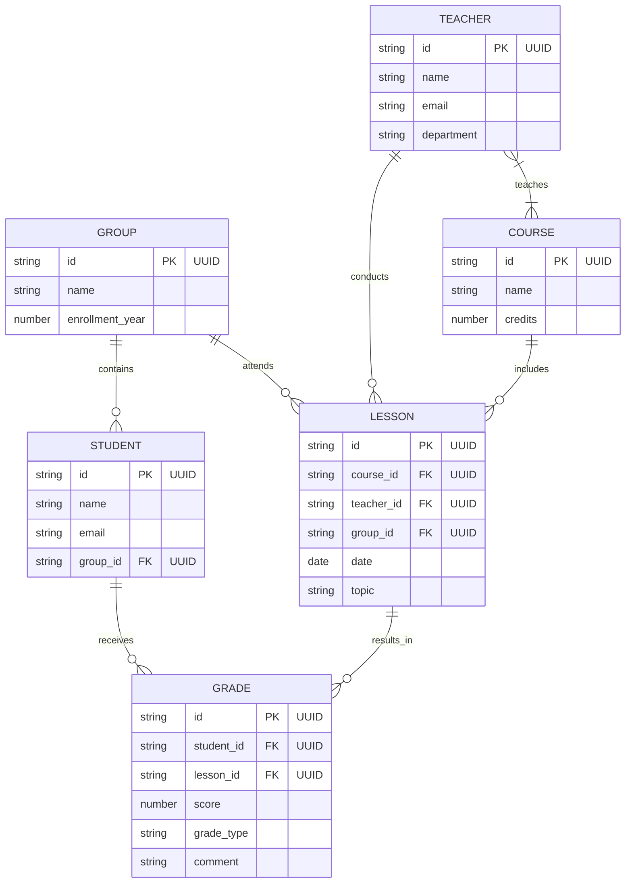

# DEFENSE — Завдання 1: Домен і модель даних (ER)

**Намір і критерії:** 
Спроєктувати ER-діаграму відповідно до 3NF. 
- **Чому цей домен:** "Електронний журнал" чітко відображає реальні бізнес-процеси (взаємодія студентів, груп, викладачів та занять).
- **Чому 3NF:** Усі сутності мають PK (`id`), неключові атрибути залежать виключно від ключа, відсутні транзитивні залежності.

**Топ-3 розбіжності (аудит) та SHA комітів-виправлень:**
1. **Типи даних та відсутні ключі:** AI спочатку видав типи `int` та пропустив позначки ключів. Виправлено на концептуальні типи з PK/FK "UUID". (Виправлено в коміті: 1d6f199)
2. **Загальні назви зв'язків:** AI використав слово `has` для всіх зв'язків. Виправлено на точні дієслова. (Виправлено в коміті: e0a244e)
3. **Пропущені зв'язки:** AI у сирій версії не пов'язав `LESSON` з іншими сутностями. Усі відношення для заняття були успішно додані. (Виправлено в коміті: e0a244e)

**Ключове рішення (ADR):** Прямий зв'язок M:N для TEACHER-COURSE, та `GRADE` як асоціативна сутність. Деталі в ADR 0001.

---
### Рендер фінальної діаграми:

---

# DEFENSE — Завдання 2: Вимоги та Use Cases

## 1. Чому обрано UC «Виставити оцінку» і такі межі сценаріїв
UC «Виставити оцінку» обрано, бо він торкається ключових сутностей моделі (TEACHER, LESSON, STUDENT, GRADE) і має кілька альтернативних шляхів: успіх, помилкове значення, повторне виставлення, чужа група. Тому деталізовано 4 сценарії Gherkin і 5 EARS-вимог. Спірні місця вирішено так: історію змін не зберігаємо (немає полів у GRADE), AES-256 не додаємо (надлишково для MVP), вхід є передумовою (Background), а не `include`, бо в сценарії це стан «Given», а не крок дії. Вибір заняття й студента лишився `include`, бо це обов'язковий підкрок.

## 2. Топ-3 розбіжності
| # | Що було не так | Як знайдено | Виправлення (SHA) |
|---|---|---|---|
| 1 | REQ-4 вимагав зберігати історію змін оцінок, а в GRADE немає ні історії, ні часу зміни. | Звірка вимог з ER-моделлю Завдання 1; додаткова вказівка в промпті. | `322044c` |
| 2 | Шифрування AES-256 було в промпті, але ШІ не включив його в жодну NFR. Розбіжність залишено свідомо як рішення для MVP. | Порівняння промпту з результатом. | `c1e9d13` (ADR 0002), `2f440b1` (лог) |
| 3 | Вхід і вибір заняття були `include` на діаграмі, але в Gherkin це передумови; також не було перевірки групи й викладача з ER (LESSON.teacher_id, group_id), а spec.md називав Email-сервіс актором. | Аудит include/extend, звірка з ER і з розділом «Поза обсягом». | `61a2078`, `85fb44c` |

## 3. Ключове рішення
Формат вимог: EARS для функціональних вимог, Gherkin для сценаріїв UC. Також зафіксовано рішення без історії змін, без AES-256 і із зовнішньою автентифікацією. Деталі: `adr/0002-requirements-approach.md` (`ee01c0c`, `c1e9d13`).

## 4. Перевірка
- Вимоги звірено з ER Завдання 1: поля історії відсутні, тому REQ-4 описує перезапис балу; REQ-5 спирається на наявні `teacher_id` і `group_id` в LESSON.
- Критерії Завдання 2 додано в spec.md окремим комітом (`85fb44c`).
- Рендер Mermaid-діаграми перевірено у веб-редакторі.
- NFR мають числові межі (1000 користувачів, p95 < 1.5 с, версії iOS/Android/Chrome/Safari) і не потрапляють у матрицю.
- Непокриті UC («Увійти в систему», «Переглянути успішність», «Експорт звіту у PDF») позначено в матриці з обґрунтуванням.