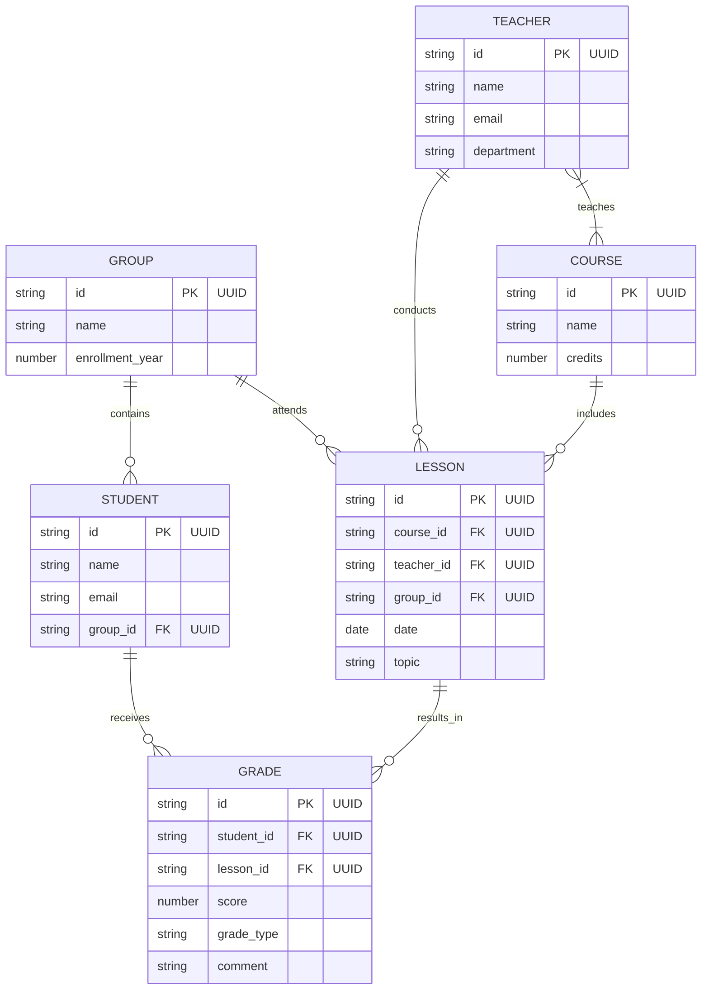

# DEFENSE — Завдання 1: Домен і модель даних (ER)

**Намір і критерії:** 
Спроєктувати ER-діаграму відповідно до 3NF. 
- **Чому цей домен:** "Електронний журнал" чітко відображає реальні бізнес-процеси (взаємодія студентів, груп, викладачів та занять).
- **Чому 3NF:** Усі сутності мають PK (`id`), неключові атрибути залежать виключно від ключа, відсутні транзитивні залежності.

**Топ-3 розбіжності (аудит) та SHA комітів-виправлень:**
1. **Типи даних та відсутні ключі:** AI спочатку видав типи `int` та пропустив позначки ключів. Виправлено на концептуальні типи з PK/FK "UUID". (Виправлено в коміті: 1d6f199)
2. **Загальні назви зв'язків:** AI використав слово `has` для всіх зв'язків. Виправлено на точні дієслова. (Виправлено в коміті: e0a244e)
3. **Пропущені зв'язки:** AI у сирій версії не пов'язав `LESSON` з іншими сутностями. Усі відношення для заняття були успішно додані. (Виправлено в коміті: e0a244e)

**Ключове рішення (ADR):** Прямий зв'язок M:N для TEACHER-COURSE, та `GRADE` як асоціативна сутність. Деталі в ADR 0001.

---
### Рендер фінальної діаграми:

---

# DEFENSE — Завдання 2: Вимоги та Use Cases

**Межі сценаріїв (Чому саме такі):**
Межі системи охоплюють виключно базовий MVP електронного журналу. До них входять управління оцінками (Викладач), перегляд успішності (Студент) та базове автоматичне сповіщення (Email-сервіс). Складні адміністративні функції (наприклад, управління безпекою та блокування акаунтів) свідомо винесені за межі поточного релізу (непокрита вимога REQ-4), щоб зберегти фокус на ключовому бізнес-процесі.

# DEFENSE
Завдання 2: Вимоги та Use Cases

**1. Що я просив у AI**: Згенерувати EARS-вимоги, NFR із числовими межами, складний UC у Gherkin (без окремих User Stories), Use Case діаграму та матрицю трасування. Промпти: `prompts/prompt-02-use-cases.md`.

**2. Топ-3 розбіжності, які я знайшов і виправив** (spec → вихід AI):
| # | Що було не так (проти якого пункту spec) | Мій слід (промпт / фідбек / дод. spec) | Виправлення (коміт) |
|---|---|---|---|
| 1 | AI згенерував окремий блок User Stories (порушення формату "один артефакт") | `prompts/prompt-02-use-cases.md` (Prompt 4) | (цей коміт) |
| 2 | NFR були абстрактними без метрик (проти вимоги про числа й межі) | Уточнено точні критерії навантаження та технології | (цей коміт) |
| 3 | AI включив NFR у матрицю трасування | Пряма вказівка AI прибрати NFR з матриці | (цей коміт) |

**3. Ключове рішення:**
Відмова від окремих User Stories. Мета користувача інтегрована безпосередньо в опис `Feature` для Gherkin-сценаріїв, що усуває дублювання артефактів.

**4. Перевірка:**
Перевірено узгодженість із моделлю Завдання 1 (`TEACHER`, `STUDENT`, `GRADE`). Матриця трасування покриває виключно EARS-вимоги Gherkin-сценаріями (NFR виключені). Рендер діаграми Mermaid успішний.