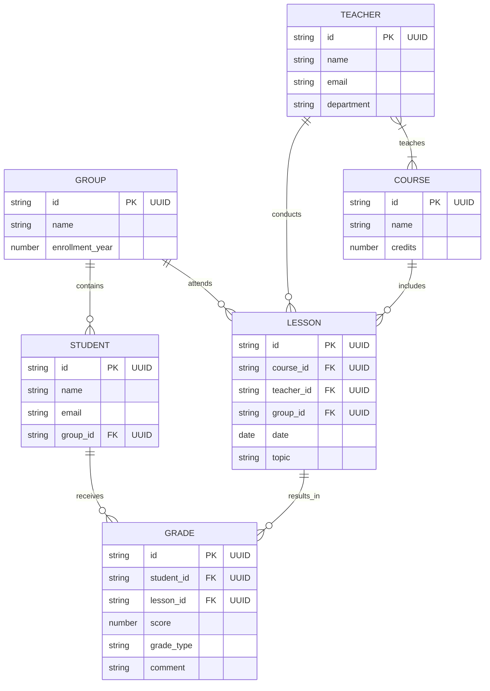

# DEFENSE — Завдання 1: Домен і модель даних (ER)

**Намір і критерії:** 
Спроєктувати ER-діаграму відповідно до 3NF. 
- **Чому цей домен:** "Електронний журнал" чітко відображає реальні бізнес-процеси (взаємодія студентів, груп, викладачів та занять).
- **Чому 3NF:** Усі сутності мають PK (`id`), неключові атрибути залежать виключно від ключа, відсутні транзитивні залежності.

**Топ-3 розбіжності (аудит) та SHA комітів-виправлень:**
1. **Типи даних та відсутні ключі:** AI спочатку видав типи `int` та пропустив позначки ключів. Виправлено на концептуальні типи з PK/FK "UUID". (Виправлено в коміті: 1d6f199)
2. **Загальні назви зв'язків:** AI використав слово `has` для всіх зв'язків. Виправлено на точні дієслова. (Виправлено в коміті: e0a244e)
3. **Пропущені зв'язки:** AI у сирій версії не пов'язав `LESSON` з іншими сутностями. Усі відношення для заняття були успішно додані. (Виправлено в коміті: e0a244e)

**Ключове рішення (ADR):** Прямий зв'язок M:N для TEACHER-COURSE, та `GRADE` як асоціативна сутність. Деталі в ADR 0001.

---
### Рендер фінальної діаграми:

---

# DEFENSE — Завдання 2: Вимоги та Use Cases

**Межі сценаріїв (Чому саме такі):**
Межі системи охоплюють виключно базовий MVP електронного журналу. До них входять управління оцінками (Викладач), перегляд успішності (Студент) та базове автоматичне сповіщення (Email-сервіс). Складні адміністративні функції (наприклад, управління безпекою та блокування акаунтів) свідомо винесені за межі поточного релізу (непокрита вимога REQ-4), щоб зберегти фокус на ключовому бізнес-процесі.

**Топ-3 розбіжності (аудит) та SHA коміту-виправлення:**
*(Всі виправлення зроблені в коміті: 0cea49b)*
1. **Двозначність EARS:** AI використовував нечіткі терміни ("quickly", "sometimes"). Їх було замінено на суворі умови та тригери (`WHEN... SHALL...`, `WHILE...`).
2. **Невідповідність сутностей:** AI вигадав сутності "Tutor" та "Pupil". Здійснено синхронізовацію з доменною моделлю Завдання 1 (`TEACHER`, `STUDENT`, `GRADE`).
3. **Відсутність структурних зв'язків:** Початкова діаграма не мала включень та розширень. Було додано базового актора `User` (узагальнення), зв'язки `include` (для обов'язкової авторизації) та `extend` (для опціонального експорту).

**Трасування:** 
Матриця успішно реалізує зв'язок багато-до-багатьох (REQ-2 покривається відразу US-1 та US-3) та містить свідомо непокриту вимогу REQ-4 з обґрунтуванням.