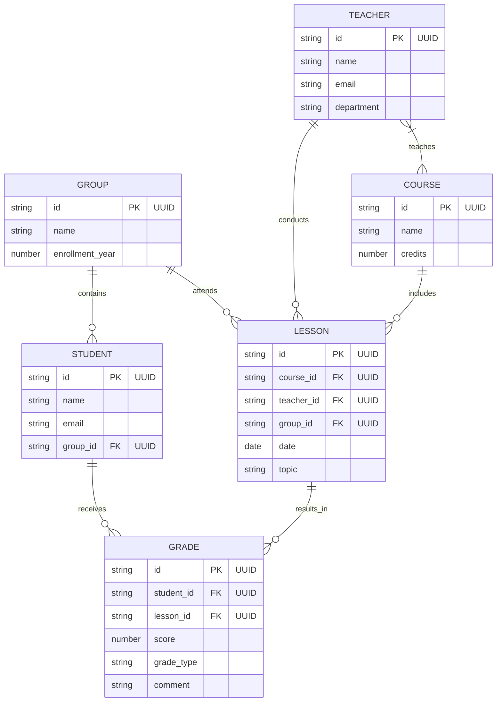

# DEFENSE — Завдання 1: Домен і модель даних (ER)

**Намір і критерії:** 
Спроєктувати ER-діаграму відповідно до 3NF. 
- **Чому цей домен:** "Електронний журнал" чітко відображає реальні бізнес-процеси (взаємодія студентів, груп, викладачів та занять).
- **Чому 3NF:** Усі сутності мають PK (`id`), неключові атрибути залежать виключно від ключа, відсутні транзитивні залежності.

**Топ-3 розбіжності (аудит) та SHA комітів-виправлень:**
1. **Типи даних та відсутні ключі:** AI спочатку видав типи `int` та пропустив позначки ключів. Виправлено на концептуальні типи з PK/FK "UUID". (Виправлено в коміті: 1d6f199)
2. **Загальні назви зв'язків:** AI використав слово `has` для всіх зв'язків. Виправлено на точні дієслова. (Виправлено в коміті: e0a244e)
3. **Пропущені зв'язки:** AI у сирій версії не пов'язав `LESSON` з іншими сутностями. Усі відношення для заняття були успішно додані. (Виправлено в коміті: e0a244e)

**Ключове рішення (ADR):** Прямий зв'язок M:N для TEACHER-COURSE, та `GRADE` як асоціативна сутність. Деталі в ADR 0001.

---
### Рендер фінальної діаграми:

---

# DEFENSE — Завдання 2: Вимоги та Use Cases

**1. Намір і критерії:** розписати вглиб один UC «Виставити оцінку» (Викладач) — діаграма → Gherkin → EARS → матриця трасування → NFR — так, щоб кожна вимога перевірялась тестом і не суперечила ER із Завдання 1. Критерії — `spec.md` §5 (п. 1–8); артефакт і рендер — `use-cases.md`.

**2. Топ-3 розбіжності (аудит виходу AI) → коміт-виправлення:**
1. **Історія змін оцінок суперечила ER** (проти `spec.md` §5 п. 7). Мій початковий запит містив вимогу історії, AI виконав її без перевірки проти моделі, хоча в GRADE немає полів для історії. Виправлено через spec/ADR: REQ-4 = заміщення балу, Gherkin S3 переписано. Слід: `ai/prompt-02-use-cases.md` (Prompt 1 → мій фідбек «видали REQ-4 про історію»). Коміт: `188c03e`.
2. **NFR були нечіткими** (проти `spec.md` §5 п. 5). У відповіді AI було «працювати на мобільних пристроях»: без версій, перцентиля й навантаження. Додано iOS 15+, Android 10+, Chrome 115+, Safari 16+, p95 < 1.5 с при 1000 одночасних користувачів. Слід: `ai/prompt-02-use-cases.md` (фідбек: «додай версії браузерів і 95-й перцентиль»). Коміт: `188c03e`.
3. **Діаграма без узагальнення акторів** (проти `spec.md` §5 п. 1). AI не створив спільного актора; додано «Користувач» з UC «Увійти в систему». Слід: `ai/prompt-02-use-cases.md` (фідбек: «додай UC для загального актора Користувач»). Коміт: `188c03e`.

**3. Ключове рішення** (`adr/0002-requirements-approach.md`): EARS + Gherkin, історії змін і AES-256 немає, автентифікація зовнішня, одна оцінка на пару «студент–заняття». Альтернативи, які зважила:
- Історія змін: окрема сутність історії в ER vs заміщення балу. Обрано заміщення: ER із Завдання 1 вже без історії, для MVP вона не потрібна; ціна — змінювати ER і REQ-4, якщо історія знадобиться.
- AES-256: додати в NFR vs винести в «Поза обсягом». Обрано друге: надлишково для MVP, обмеження зафіксоване.
- Автентифікація: облікові дані в ER vs зовнішня. Обрано зовнішню: інакше довелося б змінювати модель із Завдання 1.

**4. Перевірка (узгодженість із моделлю даних):** звірила кожну вимогу з `er-diagram.mmd`: актори Викладач ↔ TEACHER, Студент ↔ STUDENT; REQ-1…REQ-6 використовують лише наявні поля (GRADE.score, GRADE.comment, LESSON.teacher_id, LESSON.group_id, STUDENT.group_id). Перевірка кардинальностей виявила, що ER допускає кілька GRADE на пару «студент–заняття», тому правило «одна оцінка» зафіксоване в ADR 0002 п. 5. «Користувач» сутності не має (автентифікація зовнішня). Кожна вимога має сценарій — матриця в `use-cases.md` §4.