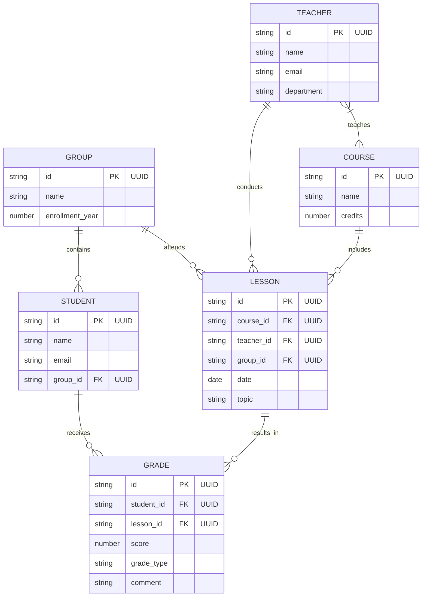

# DEFENSE — Завдання 3: Взаємодія (Sequence Diagram)

> Завдання 2 і Завдання 1 — нижче в цьому файлі, без змін.

**1. Намір і критерії.** Показати, що відбувається всередині системи в кожному сценарії UC «Виставити оцінку» (S1–S5, плюс S6 — доступ Студента): шість sequence-діаграм, узгоджених з ER (Завдання 1) і Gherkin/REQ (Завдання 2). Специфікація: `spec.md` §6; артефакт: `sequence-diagrams.md`.

**2. Топ-3 розбіжності** (перша версія ↔ spec):
 1. Діаграми S1 і S5 створювали GRADE зі значенням `gradeTypeDefault`, а Завдання 2 не визначає `grade_type` (проти `spec.md` §6, крит. 6: нічого поза Завданням 2) | `spec.md` §6: явне припущення A2 + ADR 0004 — `bdeda92` |
 2. S1 показував поточні оцінки в списку групи (`loop`, `currentScores`), чого немає в Gherkin/REQ (крит. 6); без цього S3 («студент уже має 90») не мав опори | припущення A1 + ADR 0004 — `bdeda92` |
 3. Примітки «Given» перекривали підписи акторів на діаграмах (крит. 1: діаграма читається) | `sequence-diagrams.md`: примітки перенесено над UI/GradeService — `5b32845` |

Розбіжності 1–2 знайдено запуском `scripts/check_sequence.py` на першій версії, розбіжність 3 — оглядом рендера.

**3. Ключове рішення** (`adr/0004-sequence-participants.md`): учасники — актори, GradebookUI, GradeService і сутності ER (LESSON, STUDENT, GRADE); одна діаграма на сценарій (S2 і S4 — на Scenario Outline). Альтернативи, які зважила: єдиний учасник «Database» (відкинуто: губиться зв'язок з ER); учасники-репозиторії (відкинуто: цей шар належить Завданню 5, архітектурі); діаграма на кожен рядок Examples (відкинуто: різняться лише вхідні дані).

**4. Перевірка:**
- З ER (Завдання 1): учасники LESSON, STUDENT, GRADE і поля teacher_id, group_id, score, comment є в `er-diagram.mmd`.
- З Gherkin і REQ (Завдання 2): кроки кожного сценарію зіставлені з повідомленнями в таблиці наприкінці `sequence-diagrams.md`; тексти помилок і код 403 — дослівно.
- Відтворювана перевірка: `python scripts/check_sequence.py` — на першій версії 2 проблеми, на фінальній `OK`.

---

# DEFENSE — Завдання 2: Вимоги та Use Cases

> Завдання 1 (ER-модель) — нижче в цьому файлі, без змін.

**1. Намір і критерії:** розписати вглиб один UC «Виставити оцінку» (Викладач) — діаграма → Gherkin → EARS → матриця трасування → NFR — так, щоб кожна вимога перевірялась тестом і не суперечила ER із Завдання 1. Критерії — `spec.md` §5; артефакт і рендер — `use-cases.md`.

**2. Топ-3 розбіжності → коміт-виправлення** (описано так, як видно в історії; слід AI — `prompts/prompt-02-use-cases-export.md`: раунд 1 — мій запит і відповідь AI, раунд 2 — мій фідбек):
1. **Історія змін оцінок суперечила ER** (проти `spec.md` §5 п. 7). Вихід AI (`prompts/prompt-02-use-cases-export.md`, раунд 1): REQ-4 «записати історію змін з міткою часу» і сценарій зміни оцінки зі створенням запису в історії; у git (`e837446`): REQ-4 «перезаписати бал та зберегти історію змін». У GRADE немає полів для історії. Виправлено в `322044c`: історію з REQ-4 прибрано, REQ-4 = заміщення балу; рішення — ADR 0002 п. 2. Фідбек: раунд 2 («Видали REQ-4 про історію…»). Коміт: `322044c`.
2. **NFR без чисел і меж** (проти `spec.md` §5 п. 5). Вихід AI (раунд 1): NFR-1 «на мобільних пристроях та десктопах», NFR-2 «високе навантаження», NFR-3 «мінімальним». У git до виправлення (`e837446`): NFR-1 «iOS 15+, Android 10+ та сучасних браузерів» (без версій браузерів), NFR-3 «< 1.5 секунди при завантаженні списку оцінок» (без перцентиля). Виправлено в `322044c`: Chrome 115+, Safari 16+, p95 < 1.5 с; прив'язку NFR-3 до 1000 одночасних користувачів і межі черги додано пізніше (`bc9ffa6`). Фідбек: раунд 2 («Уточни NFR…»). Коміт: `322044c`.
3. **Узагальнення акторів без UC у «Користувача»** (проти `spec.md` §5 п. 1). Вихід AI (раунд 1): діаграма без узагальнення акторів; у git (`e837446`): «Користувач» з узагальненням уже є, але без власного UC, тому узагальнення не мало змісту. Виправлено в `322044c`: додано UC «Увійти в систему» та include (у раунді 2 AI запропонував include з обох UC; пізніше include переглянуто в `bc9ffa6`). Фідбек: раунд 2 («Додай "Увійти в систему" як UC…»). Коміт: `322044c`.

**3. Ключове рішення** (`adr/0002-requirements-approach.md`, `adr/0003-requirements-scope-approach.md`): формат EARS + Gherkin; вимоги уточнюються від сценаріїв одного UC. Альтернативи, які зважила:
- Підхід: повний формальний опис усіх UC наперед vs від сценаріїв одного UC. Обрано друге: вимоги без сценаріїв не перевіряються, обсяг неспівмірний із завданням; ціна — решта UC без вимог (ADR 0003).
- Історія змін: окрема сутність історії в ER vs заміщення балу. Обрано заміщення: ER із Завдання 1 вже без історії; ціна — змінювати ER і REQ-4, якщо історія знадобиться (ADR 0002).
- AES-256: NFR vs «Поза обсягом». Обрано друге: надлишково для MVP (ADR 0002).
- Автентифікація: облікові дані в ER vs зовнішня. Обрано зовнішню: інакше довелося б змінювати модель із Завдання 1 (ADR 0002).
- Правило «403 на чужі оцінки»: NFR vs функціональна вимога. Обрано REQ-7 зі сценарієм S6: це поведінка у відповідь на запит, а не якість (ADR 0003).

**4. Перевірка (узгодженість із моделлю даних):** звірила кожну вимогу з `er-diagram.mmd`: Викладач ↔ TEACHER, Студент ↔ STUDENT; REQ-1…REQ-7 використовують лише наявні поля (GRADE.score, GRADE.comment, GRADE.student_id, LESSON.teacher_id, LESSON.group_id, STUDENT.group_id). Перевірка кардинальностей показала, що ER допускає кілька GRADE на пару «студент–заняття», тому правило «одна оцінка» зафіксоване в ADR 0002 п. 5. «Користувач» сутності не має (автентифікація зовнішня). Кожна вимога має сценарій — матриця в `use-cases.md` §4.

---

# DEFENSE — Завдання 1: Домен і модель даних (ER)

**Намір і критерії:** 
Спроєктувати ER-діаграму відповідно до 3NF. 
- **Чому цей домен:** "Електронний журнал" чітко відображає реальні бізнес-процеси (взаємодія студентів, груп, викладачів та занять).
- **Чому 3NF:** Усі сутності мають PK (`id`), неключові атрибути залежать виключно від ключа, відсутні транзитивні залежності.

**Топ-3 розбіжності (аудит) та SHA комітів-виправлень:**
1. **Типи даних та відсутні ключі:** AI спочатку видав типи `int` та пропустив позначки ключів. Виправлено на концептуальні типи з PK/FK "UUID". (Виправлено в коміті: 1d6f199)
2. **Загальні назви зв'язків:** AI використав слово `has` для всіх зв'язків. Виправлено на точні дієслова. (Виправлено в коміті: e0a244e)
3. **Пропущені зв'язки:** AI у сирій версії не пов'язав `LESSON` з іншими сутностями. Усі відношення для заняття були успішно додані. (Виправлено в коміті: e0a244e)

**Ключове рішення (ADR):** Прямий зв'язок M:N для TEACHER-COURSE, та `GRADE` як асоціативна сутність. Деталі в ADR 0001.

---
### Рендер фінальної діаграми:
