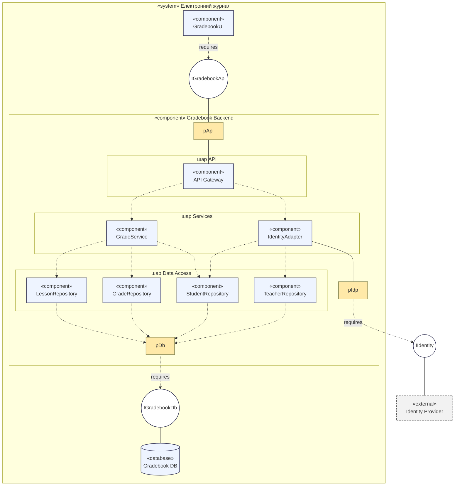

# Архітектура: діаграма компонентів

Артефакт Завдання 5: діаграма компонентів власної системи «Електронний журнал» (Mermaid, цей файл), рендер — `architecture.svg`, `architecture.png` (створено з діаграми нижче). Специфікація — `spec.md` §8, ключове рішення — `adr/0006-architecture-layers.md`. Перевірка: `scripts/check_architecture.py`.

## 1. Діаграма



**Умовні позначення.** Mermaid не має вбудованих lollipop і socket, тому нотація така: кружок — інтерфейс (lollipop): суцільна лінія від кружка до постачальника (provided); пунктирна стрілка до кружка з підписом `requires` — споживач (socket); жовтий квадрат — порт, де компонент має зовнішнє з'єднання; звичайна пунктирна стрілка без підпису — залежність усередині модуля (uses). Прямокутник «system» — межа системи; сірий пунктирний прямокутник — зовнішня система.

**Напрямки.** Згори донизу: клієнт → backend (шари API → Services → Data Access) → база даних. Усередині шару зліва направо: GradeService, IdentityAdapter; LessonRepository, GradeRepository, StudentRepository, TeacherRepository. Зовнішній Identity Provider — праворуч, поза межею системи.

## 2. Архітектурний варіант

Обрано горизонтальні шари, послідовно в усій системі: Presentation → API → Services → Data Access → Database. Модулі за можливостями (оцінки, ідентифікація) не вводяться: усі сценарії Sequence (Завдання 3) проходять згори донизу через ті самі шари. Змішаного варіанту немає; великий компонент `Gradebook Backend` лише об'єднує шари API, Services, Data Access і несе порти. Обґрунтування й альтернативи — ADR 0006.

## 3. Компоненти і трасування до попередніх моделей

| Компонент | Шар | Дані (ER, Завдання 1) | Вимоги / UC / припущення (Завдання 2, 4) | Sequence (Завдання 3) | Процес BPMN (Завдання 4) |
|---|---|---|---|---|---|
| `GradebookUI` | Presentation | — | NFR-1, NFR-4, Виставити оцінку, Переглянути успішність | GradebookUI | GradebookUI |
| `API Gateway` | API | — | NFR-2, NFR-3, Увійти в систему, A3, A5 | — | — |
| `GradeService` | Services | — | REQ-1, REQ-2, REQ-3, REQ-4, REQ-5, REQ-6, REQ-7, Виставити оцінку, Переглянути успішність, A4 | GradeService | GradeService |
| `IdentityAdapter` | Services | TEACHER, STUDENT | Увійти в систему, A6, ADR 0002 п. 4 | — | — |
| `LessonRepository` | Data Access | LESSON | — | LESSON | LESSON |
| `StudentRepository` | Data Access | STUDENT | A6 | STUDENT | STUDENT |
| `GradeRepository` | Data Access | GRADE | A4 | GRADE | GRADE |
| `TeacherRepository` | Data Access | TEACHER | A6 | — | — |
| `Gradebook DB` | Database | STUDENT, GROUP, TEACHER, COURSE, LESSON, GRADE | — | — | — |
| `Identity Provider` | поза межею | — | Увійти в систему, ADR 0002 п. 4 | — | — |

## 4. Інтерфейси

| Інтерфейс | Постачальник (provided) | Споживачі (required) | Операції | Протокол |
|---|---|---|---|---|
| `IGradebookApi` | `API Gateway` (через `pApi`) | `GradebookUI` | getMyLessons, getGroupRoster, saveGrade, getGrades, login | REST/HTTPS |
| `IGradebookDb` | `Gradebook DB` | `LessonRepository`, `StudentRepository`, `GradeRepository`, `TeacherRepository` | query, execute | SQL |
| `IIdentity` | `Identity Provider` | `IdentityAdapter` | authorize, exchangeCode, validateToken | OAuth 2.0 / OIDC |

Lollipop лише там, де є змінний постачальник або споживач: публічний API (клієнти web і mobile, NFR-1), база даних, зовнішній провайдер ідентифікації. Усередині `Gradebook Backend` контракти між шарами — звичайні залежності (пунктирні стрілки), без lollipop.

## 5. Залежності всередині backend

| Залежність | Навіщо |
|---|---|
| `API Gateway` → `GradeService` | Gateway передає запити сервісу оцінок |
| `API Gateway` → `IdentityAdapter` | перевірка сесії й вхід |
| `GradeService` → `LessonRepository` | заняття (findById, findByTeacher) |
| `GradeService` → `GradeRepository` | оцінки (findByStudentAndLesson, create, updateGrade, findByStudent) |
| `GradeService` → `StudentRepository` | студенти групи (findById, findByGroup) |
| `IdentityAdapter` → `StudentRepository` | Студент за email (A6) |
| `IdentityAdapter` → `TeacherRepository` | Викладач за email (A6) |
| `LessonRepository` → `pDb` | доступ до даних |
| `GradeRepository` → `pDb` | доступ до даних |
| `StudentRepository` → `pDb` | доступ до даних |
| `TeacherRepository` → `pDb` | доступ до даних |

## 6. Межа системи та зовнішні інтеграції

- **Усередині межі:** `GradebookUI`, `Gradebook Backend` (`API Gateway`, `GradeService`, `IdentityAdapter`, `LessonRepository`, `StudentRepository`, `GradeRepository`, `TeacherRepository`), `Gradebook DB`.
- **Зовнішні інтеграції (поза межею, система залежить, але не реалізує):** `Identity Provider` — автентифікація зовнішня (ADR 0002, п. 4); UC «Увійти в систему» (Завдання 2).
- **Явно поза моделлю:** Email-сервіс — «Поза обсягом» у Завданні 2: зовнішня система, не актор, жоден сценарій її не викликає.
- **Черга повідомлень:** не потрібна — усі сценарії синхронні (Sequence, Завдання 3), Викладач чекає відповіді (BPMN, Завдання 4); черга з NFR-2 — це черга допуску запитів усередині API Gateway, а не брокер повідомлень.
- **Довідкові дані:** сутності STUDENT, GROUP, TEACHER, COURSE, LESSON у сценаріях лише читаються; їх наповнення відбувається поза моделлю (припущення A7). Записує дані система лише для GRADE (`GradeRepository.create`, `updateGrade`).

## 7. Процес і архітектура: повідомлення BPMN

| Повідомлення BPMN | Де реалізовано в архітектурі |
|---|---|
| `submitGrade` | Викладач → `GradebookUI` (`submitGrade`), далі `IGradebookApi.saveGrade` |
| `GradeSaved` | відповідь `IGradebookApi.saveGrade` → `GradebookUI` показує підтвердження |
| `GradeUpdated` | відповідь `IGradebookApi.saveGrade` (оновлення) → `GradebookUI` |
| `ValidationError` | відповідь `IGradebookApi.saveGrade` → `GradebookUI`, повернення до введення балу |
| `AccessDenied` | відповідь `IGradebookApi.saveGrade` → `GradebookUI` |

## 8. Модель для перевірки

Діаграма й таблиці згенеровані з цієї моделі; скрипт перевірки порівнює з нею кожен вузол і зв'язок діаграми.

```json
{
 "boundary": "Електронний журнал",
 "layers": [
  "Presentation",
  "API",
  "Services",
  "Data Access",
  "Database"
 ],
 "components": [
  {
   "id": "UI",
   "name": "GradebookUI",
   "layer": "Presentation",
   "container": null,
   "node": "comp",
   "stereotype": "component",
   "ops": [
    "openJournal",
    "selectLesson",
    "submitGrade",
    "enterScore",
    "enterComment",
    "openGrades",
    "attachComment"
   ],
   "trace": {
    "er": [],
    "req": [
     "NFR-1",
     "NFR-4"
    ],
    "uc": [
     "Виставити оцінку",
     "Переглянути успішність"
    ],
    "sequence": [
     "GradebookUI"
    ],
    "bpmn": [
     "GradebookUI"
    ],
    "assumptions": [],
    "adr": []
   }
  },
  {
   "id": "GW",
   "name": "API Gateway",
   "layer": "API",
   "container": "BE",
   "node": "comp",
   "stereotype": "component",
   "ops": [],
   "trace": {
    "er": [],
    "req": [
     "NFR-2",
     "NFR-3"
    ],
    "uc": [
     "Увійти в систему"
    ],
    "sequence": [],
    "bpmn": [],
    "assumptions": [
     "A3",
     "A5"
    ],
    "adr": []
   }
  },
  {
   "id": "GS",
   "name": "GradeService",
   "layer": "Services",
   "container": "BE",
   "node": "comp",
   "stereotype": "component",
   "ops": [
    "getMyLessons",
    "getGroupRoster",
    "saveGrade",
    "getGrades",
    "validateScore",
    "checkAccess"
   ],
   "trace": {
    "er": [],
    "req": [
     "REQ-1",
     "REQ-2",
     "REQ-3",
     "REQ-4",
     "REQ-5",
     "REQ-6",
     "REQ-7"
    ],
    "uc": [
     "Виставити оцінку",
     "Переглянути успішність"
    ],
    "sequence": [
     "GradeService"
    ],
    "bpmn": [
     "GradeService"
    ],
    "assumptions": [
     "A4"
    ],
    "adr": []
   }
  },
  {
   "id": "IA",
   "name": "IdentityAdapter",
   "layer": "Services",
   "container": "BE",
   "node": "comp",
   "stereotype": "component",
   "ops": [
    "resolveUser",
    "login"
   ],
   "trace": {
    "er": [
     "TEACHER",
     "STUDENT"
    ],
    "req": [],
    "uc": [
     "Увійти в систему"
    ],
    "sequence": [],
    "bpmn": [],
    "assumptions": [
     "A6"
    ],
    "adr": [
     "ADR 0002 п. 4"
    ]
   }
  },
  {
   "id": "LR",
   "name": "LessonRepository",
   "layer": "Data Access",
   "container": "BE",
   "node": "comp",
   "stereotype": "component",
   "ops": [
    "findById",
    "findByTeacher"
   ],
   "trace": {
    "er": [
     "LESSON"
    ],
    "req": [],
    "uc": [],
    "sequence": [
     "LESSON"
    ],
    "bpmn": [
     "LESSON"
    ],
    "assumptions": [],
    "adr": []
   }
  },
  {
   "id": "SR",
   "name": "StudentRepository",
   "layer": "Data Access",
   "container": "BE",
   "node": "comp",
   "stereotype": "component",
   "ops": [
    "findById",
    "findByGroup",
    "findByEmail"
   ],
   "trace": {
    "er": [
     "STUDENT"
    ],
    "req": [],
    "uc": [],
    "sequence": [
     "STUDENT"
    ],
    "bpmn": [
     "STUDENT"
    ],
    "assumptions": [
     "A6"
    ],
    "adr": []
   }
  },
  {
   "id": "GR",
   "name": "GradeRepository",
   "layer": "Data Access",
   "container": "BE",
   "node": "comp",
   "stereotype": "component",
   "ops": [
    "findByStudentAndLesson",
    "findByStudent",
    "create",
    "updateGrade"
   ],
   "trace": {
    "er": [
     "GRADE"
    ],
    "req": [],
    "uc": [],
    "sequence": [
     "GRADE"
    ],
    "bpmn": [
     "GRADE"
    ],
    "assumptions": [
     "A4"
    ],
    "adr": []
   }
  },
  {
   "id": "TR",
   "name": "TeacherRepository",
   "layer": "Data Access",
   "container": "BE",
   "node": "comp",
   "stereotype": "component",
   "ops": [
    "findByEmail"
   ],
   "trace": {
    "er": [
     "TEACHER"
    ],
    "req": [],
    "uc": [],
    "sequence": [],
    "bpmn": [],
    "assumptions": [
     "A6"
    ],
    "adr": []
   }
  },
  {
   "id": "DB",
   "name": "Gradebook DB",
   "layer": "Database",
   "container": null,
   "node": "db",
   "stereotype": "database",
   "ops": [],
   "trace": {
    "er": [
     "STUDENT",
     "GROUP",
     "TEACHER",
     "COURSE",
     "LESSON",
     "GRADE"
    ],
    "req": [],
    "uc": [],
    "sequence": [],
    "bpmn": [],
    "assumptions": [],
    "adr": []
   }
  },
  {
   "id": "IdP",
   "name": "Identity Provider",
   "layer": "external",
   "container": null,
   "node": "ext",
   "stereotype": "external",
   "ops": [],
   "trace": {
    "er": [],
    "req": [],
    "uc": [
     "Увійти в систему"
    ],
    "sequence": [],
    "bpmn": [],
    "assumptions": [],
    "adr": [
     "ADR 0002 п. 4"
    ]
   }
  }
 ],
 "ports": [
  {
   "id": "pApi",
   "name": "pApi",
   "container": "BE",
   "delegate": "GW"
  },
  {
   "id": "pIdp",
   "name": "pIdp",
   "container": "BE",
   "delegate": "IA"
  },
  {
   "id": "pDb",
   "name": "pDb",
   "container": "BE",
   "delegate": null
  }
 ],
 "interfaces": [
  {
   "id": "IApi",
   "name": "IGradebookApi",
   "provider": "pApi",
   "provider_component": "GW",
   "consumers": [
    "UI"
   ],
   "ops": [
    "getMyLessons",
    "getGroupRoster",
    "saveGrade",
    "getGrades",
    "login"
   ],
   "via": "REST/HTTPS"
  },
  {
   "id": "IDb",
   "name": "IGradebookDb",
   "provider": "DB",
   "provider_component": "DB",
   "consumers": [
    "LR",
    "SR",
    "GR",
    "TR"
   ],
   "ops": [
    "query",
    "execute"
   ],
   "via": "SQL"
  },
  {
   "id": "IIdp",
   "name": "IIdentity",
   "provider": "IdP",
   "provider_component": "IdP",
   "consumers": [
    "IA"
   ],
   "ops": [
    "authorize",
    "exchangeCode",
    "validateToken"
   ],
   "via": "OAuth 2.0 / OIDC"
  }
 ],
 "provides": [
  [
   "IApi",
   "pApi"
  ],
  [
   "IDb",
   "DB"
  ],
  [
   "IIdp",
   "IdP"
  ]
 ],
 "requires": [
  [
   "UI",
   "IApi"
  ],
  [
   "pDb",
   "IDb"
  ],
  [
   "pIdp",
   "IIdp"
  ]
 ],
 "uses": [
  [
   "GW",
   "GS"
  ],
  [
   "GW",
   "IA"
  ],
  [
   "GS",
   "LR"
  ],
  [
   "GS",
   "GR"
  ],
  [
   "GS",
   "SR"
  ],
  [
   "IA",
   "SR"
  ],
  [
   "IA",
   "TR"
  ],
  [
   "LR",
   "pDb"
  ],
  [
   "GR",
   "pDb"
  ],
  [
   "SR",
   "pDb"
  ],
  [
   "TR",
   "pDb"
  ]
 ],
 "delegations": [
  [
   "pApi",
   "GW"
  ],
  [
   "IA",
   "pIdp"
  ]
 ],
 "external": [
  {
   "id": "IdP",
   "name": "Identity Provider",
   "why": "автентифікація зовнішня (ADR 0002, п. 4); UC «Увійти в систему» (Завдання 2)"
  }
 ],
 "excluded": [
  {
   "name": "Email-сервіс",
   "why": "«Поза обсягом» у Завданні 2: зовнішня система, не актор, жоден сценарій її не викликає"
  }
 ],
 "message_queue": {
  "needed": false,
  "why": "усі сценарії синхронні (Sequence, Завдання 3), Викладач чекає відповіді (BPMN, Завдання 4); черга з NFR-2 — це черга допуску запитів усередині API Gateway, а не брокер повідомлень"
 },
 "reference_data": [
  {
   "entity": "STUDENT",
   "why": "лише читається в сценаріях; наповнюється поза моделлю (адміністрування й імпорт довідкових даних), створення занять — «Поза обсягом» (Завдання 2)",
   "assumption": "A7"
  },
  {
   "entity": "GROUP",
   "why": "лише читається в сценаріях; наповнюється поза моделлю (адміністрування й імпорт довідкових даних), створення занять — «Поза обсягом» (Завдання 2)",
   "assumption": "A7"
  },
  {
   "entity": "TEACHER",
   "why": "лише читається в сценаріях; наповнюється поза моделлю (адміністрування й імпорт довідкових даних), створення занять — «Поза обсягом» (Завдання 2)",
   "assumption": "A7"
  },
  {
   "entity": "COURSE",
   "why": "лише читається в сценаріях; наповнюється поза моделлю (адміністрування й імпорт довідкових даних), створення занять — «Поза обсягом» (Завдання 2)",
   "assumption": "A7"
  },
  {
   "entity": "LESSON",
   "why": "лише читається в сценаріях; наповнюється поза моделлю (адміністрування й імпорт довідкових даних), створення занять — «Поза обсягом» (Завдання 2)",
   "assumption": "A7"
  }
 ]
}
```