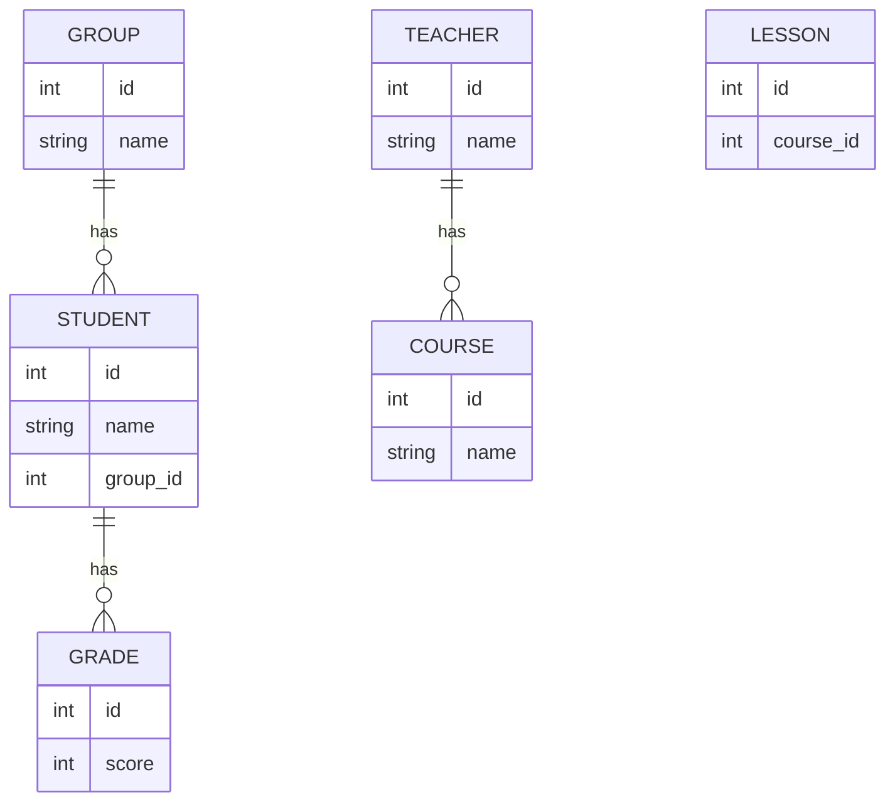

# Лог генерації ER-діаграми

## Prompt 1
**Запит до AI:** Зроби концептуальну ER-діаграму у форматі Mermaid для системи "Електронний журнал". Сутності: STUDENT, GROUP, TEACHER, COURSE, LESSON, GRADE.

**Відповідь AI (первинна, сира):**

## Prompt 2 (Фідбек щодо типів)
**Запит до AI:** Ти використав технічні типи `int` та пропустив частину атрибутів. Заміни всі `id` на `string id PK "UUID"`. Зовнішні ключі познач як `FK "UUID"`. Додай усі атрибути зі специфікації, використовуй `string`, `number`, `date`. Зв'язок викладача і предмета зроби M:N (`}|--|{`).

**Відповідь AI:**
AI виправив ключі та типи даних на концептуальні. Але назви зв'язків залишилися загальними (`has`), а зв'язки для LESSON все ще відсутні.

## Prompt 3 (Фідбек щодо зв'язків)
**Запит до AI:** Заміни `has` на конкретні дієслова (contains, attends, teaches, receives, conducts, includes, results_in). Ти пропустив зв'язки між GROUP та LESSON, TEACHER та LESSON, COURSE та LESSON. Додай їх.

**Відповідь AI (фінальна):**
AI успішно додав усі пропущені зв'язки та замінив `has` на дієслова. Згенеровано фінальну діаграму.