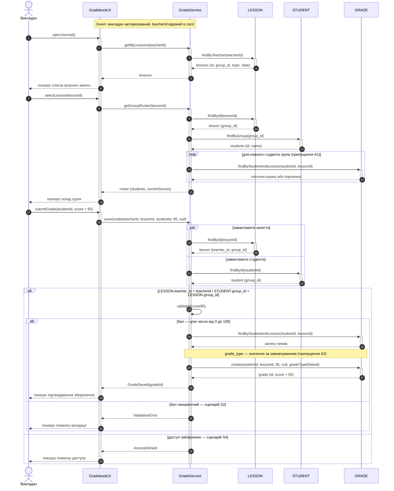
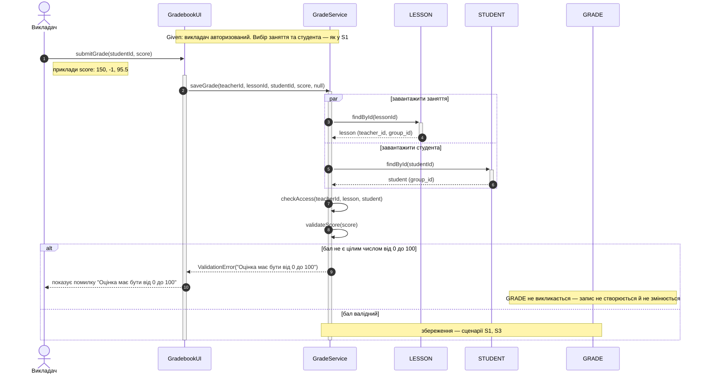
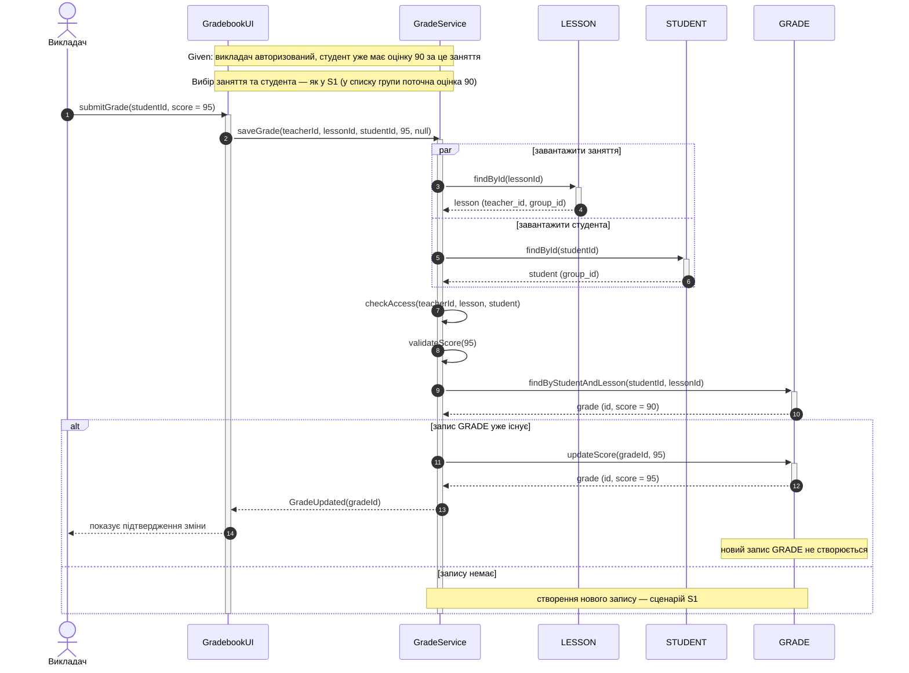
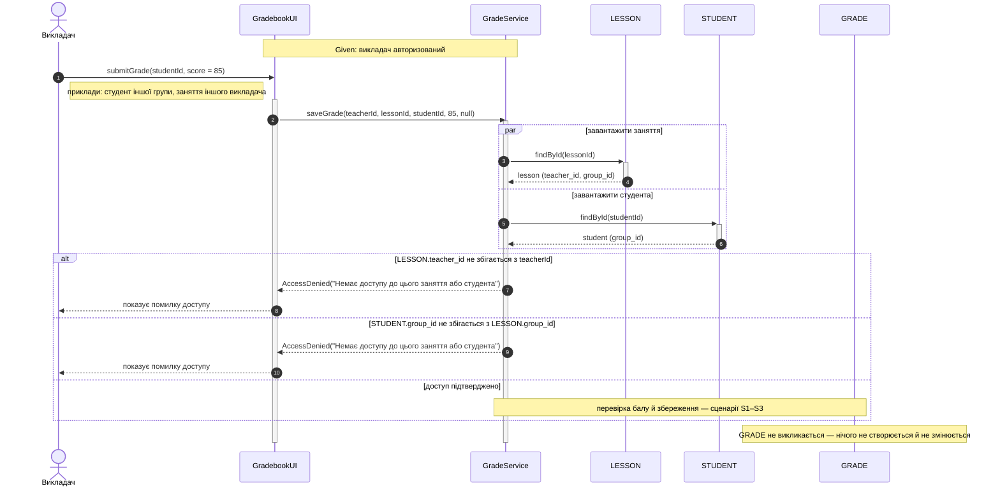
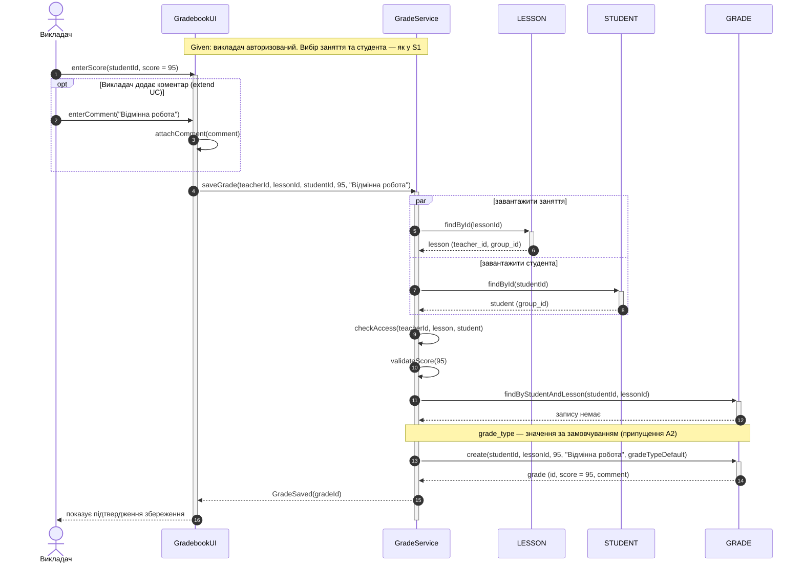
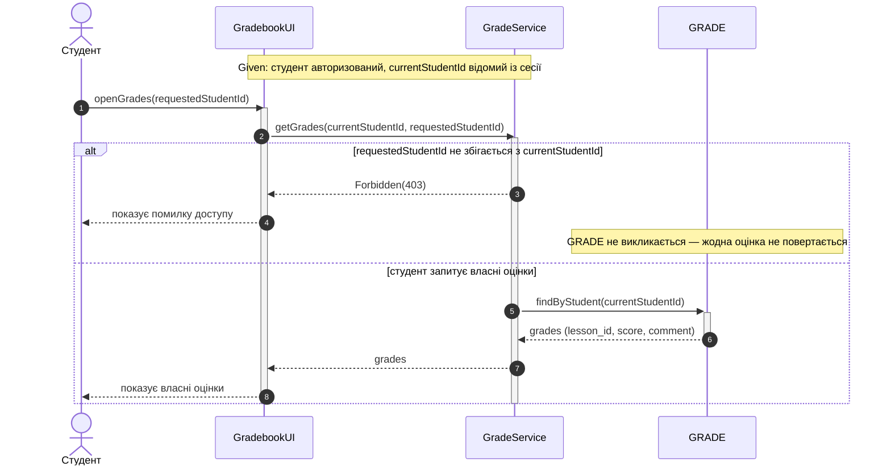

# Взаємодія: Sequence-діаграми сценаріїв UC «Виставити оцінку»

Джерела: сценарії S1–S6 і вимоги REQ-1…REQ-7 — `use-cases.md` (Завдання 2); сутності й поля — `er-diagram.mmd` (Завдання 1).

**Припущення детальнішого рівня** (не змінюють вимоги Завдання 2): A1 — список групи показує поточну оцінку за заняття (потрібно для S3); A2 — `grade_type` при створенні має значення за замовчуванням (ADR 0002, п. 5). Деталі — `spec.md` §6, ADR 0004.

**Учасники.** Викладач / Студент — актори (TEACHER / STUDENT з ER); `GradebookUI` — клієнт; `GradeService` — прикладний сервіс; `LESSON`, `STUDENT`, `GRADE` — сутності ER (доступ до даних).

## S1. Викладач успішно додає валідну оцінку

Gherkin: Background «викладач авторизований» → «обирає своє заняття та студента групи» → «вводить бал "95"» → «система створює запис GRADE з балом "95"». Вимоги: REQ-1, REQ-2, REQ-5.

## S2. Викладач вводить некоректний бал

Gherkin (Scenario Outline): бал "150" / "-1" / "95.5" → «система відхиляє збереження» → помилка "Оцінка має бути від 0 до 100" → «запис GRADE не створюється і не змінюється». Вимоги: REQ-1, REQ-3.

## S3. Викладач змінює вже виставлену оцінку

Gherkin: «студент вже має оцінку "90" за це заняття» → «вводить новий бал "95"» → «система замінює бал на "95" в наявному записі GRADE» → «новий запис GRADE не створюється». Вимоги: REQ-1, REQ-4.

## S4. Викладач намагається виставити оцінку без доступу

Gherkin (Scenario Outline): «студент іншої групи» за «своє заняття» / «студент групи заняття» за «заняття іншого викладача» → «система відхиляє збереження» → помилка доступу "Немає доступу до цього заняття або студента". Вимога: REQ-5.

## S5. Викладач додає коментар до оцінки (extend)

Gherkin: «вводить бал "95" і коментар "Відмінна робота"» → «система створює запис GRADE з балом "95" і коментарем "Відмінна робота"». Вимоги: REQ-1, REQ-2, REQ-6.

## S6. Студент запитує оцінки іншого студента (UC «Переглянути успішність», доступ)

Gherkin: «студент відкриває оцінки іншого студента» → «система відповідає 403» → «жодна оцінка іншого студента не повертається». Вимога: REQ-7.

## Трасування кроків Gherkin → повідомлення діаграм

| Сценарій | Крок Gherkin | Повідомлення на діаграмі |
|----------|--------------|--------------------------|
| S1 | обирає своє заняття та студента групи | `openJournal()`, `getMyLessons()`, `selectLesson()`, `getGroupRoster()` |
| S1 | вводить бал "95" | `submitGrade()`, `saveGrade()`, `validateScore()` |
| S1 | система створює запис GRADE | `findByStudentAndLesson()` → `create()` → `GradeSaved` |
| S2 | вводить бал "150" / "-1" / "95.5" | `submitGrade()`, `saveGrade()`, `validateScore()` |
| S2 | відхиляє збереження, показує помилку | `ValidationError("Оцінка має бути від 0 до 100")` |
| S2 | запис GRADE не створюється і не змінюється | `GRADE` не викликається |
| S3 | студент вже має оцінку "90" | `findByStudentAndLesson()` → `grade (score = 90)` |
| S3 | вводить новий бал "95" | `submitGrade()`, `saveGrade()` |
| S3 | замінює бал в наявному записі | `updateScore(gradeId, 95)` → `GradeUpdated` |
| S4 | виставляє бал студенту / за заняття без доступу | `saveGrade()`, `findById()` (LESSON, STUDENT) |
| S4 | відхиляє збереження з помилкою доступу | `AccessDenied("Немає доступу до цього заняття або студента")` |
| S5 | вводить бал "95" і коментар | `enterScore()`, `enterComment()` у фрагменті `opt` |
| S5 | створює запис GRADE з коментарем | `create(…, "Відмінна робота", …)` → `GradeSaved` |
| S6 | відкриває оцінки іншого студента | `openGrades(requestedStudentId)`, `getGrades()` |
| S6 | відповідає 403, оцінки не повертаються | `Forbidden(403)`, `GRADE` не викликається |