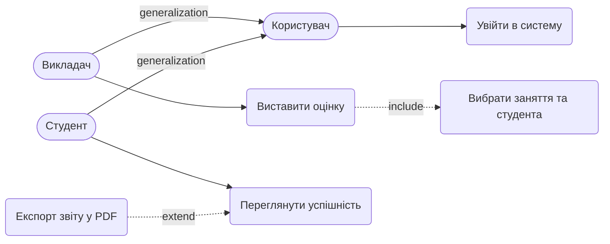

# Вимоги та Сценарії використання

## 1. Функціональні вимоги (EARS)
- **REQ-1:** WHEN Викладач ініціює виставлення оцінки, система SHALL перевірити, що бал є цілим числом від 0 до 100 включно.
- **REQ-2:** WHEN бал валідний, система SHALL зберегти запис GRADE у базі даних.
- **REQ-3:** IF бал не є цілим числом від 0 до 100, THEN система SHALL відхилити збереження та показати помилку "Оцінка має бути від 0 до 100".
- **REQ-4:** WHEN Викладач виставляє оцінку студенту за заняття, за яке вже є GRADE цього ж grade_type, система SHALL перезаписати бал (історія змін не зберігається, у GRADE немає відповідних полів).
- **REQ-5:** IF заняття проводить інший викладач або студент не належить до групи цього заняття, THEN система SHALL відхилити збереження з помилкою доступу.

## 2. Нефункціональні вимоги (NFR)
- **NFR-1 (Пристрої):** Система SHALL працювати на iOS 15+, Android 10+ та в браузерах Chrome 115+, Safari 16+.
- **NFR-2 (Навантаження):** Система SHALL витримувати 1000 одночасних користувачів. Запити понад цей ліміт SHALL ставитися в чергу довжиною до 200 запитів з очікуванням до 10 с, після чого повертається помилка "сервіс зайнятий".
- **NFR-3 (Продуктивність):** Час відгуку операції збереження та перегляду оцінок SHALL бути < 1.5 с у 95-му перцентилі. Вимірюється на сервері при навантаженні 1000 одночасних користувачів.
- **NFR-4 (Безпека):** Система SHALL відповідати 403 на 100% запитів Студента до оцінок іншого студента.

## 3. Межі системи (Поза обсягом)
- Блокування акаунтів: не потрібне для MVP.
- Експорт звітів у PDF: поза MVP, не впливає на ведення журналу.
- Сповіщення студентів через email або зовнішній API: зовнішня система не є актором, відкладено.
- Шифрування AES-256: свідомо не додано, для MVP надлишкове.
- Облікові дані (пароль, роль): у ER-моделі їх немає, автентифікація вважається зовнішньою (припущення).

## 4. Gherkin-сценарії (UC: Виставити оцінку)
**Feature: Виставити оцінку**

    Background:
      Given викладач авторизований

    Scenario: Викладач успішно додає валідну оцінку
      When викладач обирає своє заняття та студента групи
      And вводить бал "95"
      Then система зберігає запис GRADE

    Scenario: Викладач вводить некоректний бал
      When викладач обирає своє заняття та студента групи
      And вводить бал "150"
      Then система відхиляє збереження
      And показує помилку "Оцінка має бути від 0 до 100"

    Scenario: Викладач змінює вже виставлену оцінку
      Given студент вже має оцінку "90" за це заняття
      When викладач вводить новий бал "95"
      Then система перезаписує бал на "95"

    Scenario: Викладач оцінює студента не з групи заняття
      When викладач обирає заняття та студента іншої групи
      Then система відхиляє збереження з помилкою доступу

## 5. Use Case діаграма (Mermaid)

## 6. Матриця трасування
| Вимога (EARS) | Gherkin-сценарій |
|---|---|
| REQ-1, REQ-2 | Сценарій 1 |
| REQ-1, REQ-3 | Сценарій 2 |
| REQ-4 | Сценарій 3 |
| REQ-5 | Сценарій 4 |

**Непокриті UC:**
- *Увійти в систему*: автентифікація зовнішня, деталізується пізніше.
- *Переглянути успішність*: наступний спринт, NFR-4 буде перевірено там.
- *Експорт звіту у PDF*: поза обсягом MVP (розділ 3).