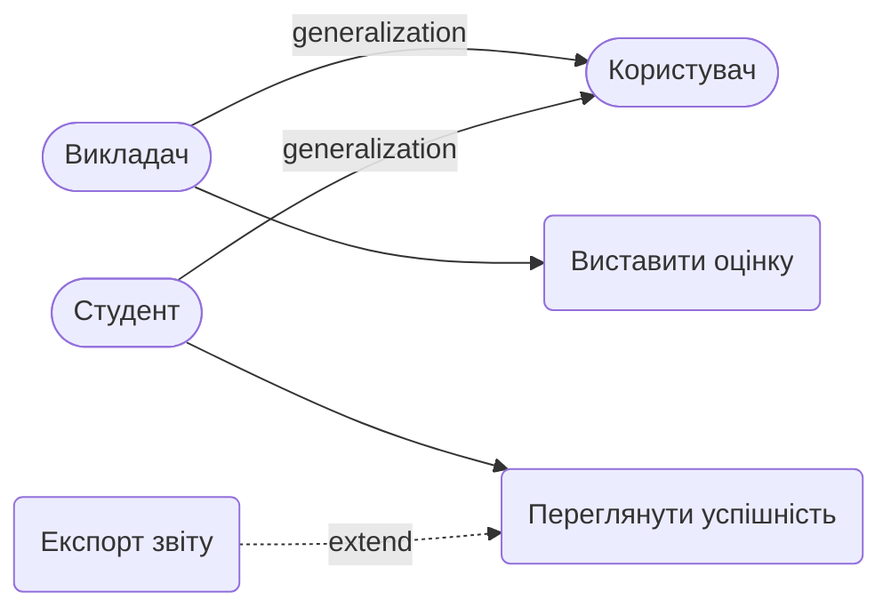

# Вимоги та Сценарії використання

## 1. Функціональні вимоги (EARS)
- **REQ-1:** WHEN Викладач ініціює виставлення оцінки, система SHALL перевірити, чи бал знаходиться в межах від 0 до 100.
- **REQ-2:** IF оцінка валідна, THEN система SHALL зберегти запис GRADE у базі даних.
- **REQ-3:** IF оцінка виходить за межі діапазону (< 0 або > 100), THEN система SHALL відхилити запит із помилкою.
- **REQ-4:** WHEN Викладач оновлює існуючу оцінку за те саме заняття, система SHALL перезаписати бал та зберегти історію змін.

## 2. Нефункціональні вимоги (NFR)
- **NFR-1 (Користувачі та пристрої):** Система SHALL підтримувати роботу Викладачів та Студентів з мобільних пристроїв (iOS 15+, Android 10+) та сучасних браузерів.
- **NFR-2 (Навантаження):** Система SHALL витримувати до 1000 одночасних користувачів. При перевищенні межі система SHALL ставити запити в чергу.
- **NFR-3 (Продуктивність):** Система SHALL забезпечувати час відгуку < 1.5 секунди при завантаженні списку оцінок.
- **NFR-4 (Безпека):** Система SHALL гарантувати, що Студент має доступ виключно до власних оцінок.
- **NFR-5 (Локалізація):** Веб-інтерфейс SHALL бути повністю україномовним.

## 3. Межі системи (Поза обсягом)
- Блокування акаунтів при підозрілих входах.
- Експорт звітів у PDF (реалізовано лише базовий перегляд).
- Інтеграція зовнішнього Email-сервісу як окремого актора.

## 4. Gherkin-сценарії (UC: Виставити оцінку)
**Feature: Виставити оцінку**

```gherkin
# Сценарій 1: Успішне виставлення оцінки
Scenario: Викладач успішно додає валідну оцінку
  Given викладач авторизований у системі
  When викладач вводить бал "95" для студента за заняття
  Then система зберігає оцінку в базі даних

# Сценарій 2: Оцінка поза допустимим діапазоном
Scenario: Викладач вводить некоректний бал
  Given викладач авторизований у системі
  When викладач вводить бал "150" для студента за заняття
  Then система відхиляє збереження
  And показує помилку "Оцінка має бути від 0 до 100"

# Сценарій 3: Повторне виставлення (зміна оцінки)
Scenario: Викладач змінює вже виставлену оцінку
  Given студент вже має оцінку "90" за поточне заняття
  When викладач вводить новий бал "95"
  Then система оновлює запис на "95"
```

## 5. Use Case Діаграма (Mermaid)


## 6. Матриця трасування
| Вимога (EARS) | Gherkin-сценарій |
|---------------|------------------|
| REQ-1, REQ-2  | Сценарій 1 (Успішне виставлення оцінки) |
| REQ-1, REQ-3  | Сценарій 2 (Оцінка поза діапазоном) |
| REQ-4         | Сценарій 3 (Повторне виставлення) |