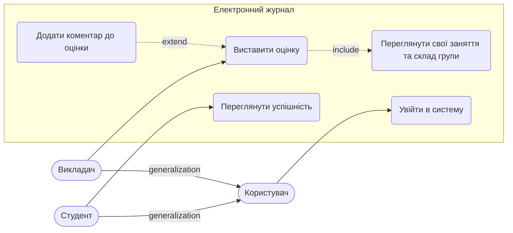

# Вимоги та Сценарії використання

**Обраний UC для розписування вглиб:** «Виставити оцінку» (актор — Викладач). Для UC «Переглянути успішність» розписано лише правило доступу (REQ-7, S6).
**Порядок документа:** UC → сценарії (Gherkin) → вимоги (EARS) → матриця трасування → NFR → межі.

## 1. Актори та UC-діаграма

- **Викладач** і **Студент** — люди; обидва успадковують абстрактного актора **Користувач**.
- Система не є актором. Email-сервіс — зовнішня система, яка сама нічого не ініціює, тому актором не є.



## 2. Gherkin-сценарії

### UC «Виставити оцінку»

```gherkin
Feature: Виставити оцінку

  Background:
    Given викладач авторизований

  # S1: Успішне виставлення оцінки
  Scenario: Викладач успішно додає валідну оцінку
    When викладач обирає своє заняття та студента групи
    And вводить бал "95"
    Then система створює запис GRADE з балом "95"

  # S2: Оцінка поза допустимим діапазоном або не ціле число
  Scenario Outline: Викладач вводить некоректний бал
    When викладач обирає своє заняття та студента групи
    And вводить бал "<бал>"
    Then система відхиляє збереження
    And показує помилку "Оцінка має бути від 0 до 100"
    And запис GRADE не створюється і не змінюється

    Examples:
      | бал  |
      | 150  |
      | -1   |
      | 95.5 |

  # S3: Повторне виставлення (зміна оцінки)
  Scenario: Викладач змінює вже виставлену оцінку
    Given студент вже має оцінку "90" за це заняття
    When викладач обирає це заняття та цього студента
    And вводить новий бал "95"
    Then система замінює бал на "95" в наявному записі GRADE
    And новий запис GRADE не створюється

  # S4: Немає доступу (чужа група або чуже заняття)
  Scenario Outline: Викладач намагається виставити оцінку без доступу
    When викладач виставляє бал "85" студенту "<студент>" за заняття "<заняття>"
    Then система відхиляє збереження
    And показує помилку доступу "Немає доступу до цього заняття або студента"

    Examples:
      | студент               | заняття                  |
      | студент іншої групи   | своє заняття             |
      | студент групи заняття | заняття іншого викладача |

  # S5: Оцінка з коментарем (extend)
  Scenario: Викладач додає коментар до оцінки
    When викладач обирає своє заняття та студента групи
    And вводить бал "95" і коментар "Відмінна робота"
    Then система створює запис GRADE з балом "95" і коментарем "Відмінна робота"
```

### UC «Переглянути успішність» (лише правило доступу)

```gherkin
Feature: Переглянути успішність (доступ)

  Background:
    Given студент авторизований

  # S6: Студент не бачить оцінок іншого студента
  Scenario: Студент запитує оцінки іншого студента
    When студент відкриває оцінки іншого студента
    Then система відповідає 403
    And жодна оцінка іншого студента не повертається
```

## 3. Функціональні вимоги (EARS)

Вимоги стосуються лише сценаріїв вище. Правила доступу — функціональні вимоги, а не NFR.

### Збереження оцінки
- **REQ-1:** WHEN Викладач ініціює виставлення оцінки, система SHALL перевірити, що бал є цілим числом від 0 до 100 включно (значення 0 і 100 допустимі).
- **REQ-2:** WHEN бал пройшов перевірку REQ-1 і для пари «студент–заняття» ще немає GRADE, система SHALL створити запис GRADE із цим балом.
- **REQ-3:** IF бал не є цілим числом від 0 до 100, THEN система SHALL відхилити збереження та показати помилку "Оцінка має бути від 0 до 100".
- **REQ-4:** WHEN бал пройшов перевірку REQ-1 і для пари «студент–заняття» вже є GRADE, система SHALL замінити в ньому бал на новий, не створюючи нового запису.
- **REQ-6:** WHEN Викладач вводить коментар разом із балом, система SHALL зберегти його в полі comment запису GRADE.

### Доступ
- **REQ-5:** IF LESSON.teacher_id не збігається з поточним Викладачем АБО STUDENT.group_id не збігається з LESSON.group_id, THEN система SHALL відхилити збереження до перевірки балу та показати помилку доступу "Немає доступу до цього заняття або студента".
- **REQ-7:** IF Студент запитує оцінки іншого студента, THEN система SHALL відповісти кодом 403 і не повертати жодної оцінки.

## 4. Матриця трасування (вимога ↔ сценарій/UC)

| Вимога | UC  | S1 | S2 | S3 | S4 | S5 | S6 |
|--------|-----|:--:|:--:|:--:|:--:|:--:|:--:|
| REQ-1  | UC1 | ✔  | ✔  | ✔  |    | ✔  |    |
| REQ-2  | UC1 | ✔  |    |    |    | ✔  |    |
| REQ-3  | UC1 |    | ✔  |    |    |    |    |
| REQ-4  | UC1 |    |    | ✔  |    |    |    |
| REQ-5  | UC1 |    |    |    | ✔  |    |    |
| REQ-6  | UC1 |    |    |    |    | ✔  |    |
| REQ-7  | UC2 |    |    |    |    |    | ✔  |

Зв'язок багато-до-багатьох: одна вимога покриває кілька сценаріїв (REQ-1 → S1, S2, S3, S5), один сценарій перевіряє кілька вимог (S5 → REQ-1, REQ-2, REQ-6). Кожна вимога має ≥1 сценарій, кожен сценарій має ≥1 вимогу. NFR не наносяться на діаграму й не трасуються.

## 5. Нефункціональні вимоги (NFR)

- **NFR-1 (Пристрої):** Система SHALL працювати на iOS 15+, Android 10+ та в браузерах Chrome 115+, Safari 16+.
- **NFR-2 (Навантаження):** Система SHALL витримувати 1000 одночасних користувачів. Запити понад цей ліміт SHALL ставитися в чергу розміром до 500 запитів; запит, що чекає в черзі понад 5 с, SHALL отримати відповідь 503.
- **NFR-3 (Продуктивність):** Час відгуку операцій збереження й перегляду оцінок SHALL бути < 1.5 с у 95-му перцентилі за навантаження до 1000 одночасних користувачів (вимірюється на сервері).
- **NFR-4 (Мова):** Інтерфейс і повідомлення про помилки SHALL бути українською мовою.

## 6. Межі системи (Поза обсягом)

- **Історія змін оцінок** — у ER-моделі (Завдання 1) немає відповідних полів; REQ-4 описує просте заміщення балу.
- **Шифрування AES-256** — свідомо не додано: надлишково для MVP (ADR 0002, п. 3).
- **Реалізація автентифікації** — зовнішня, у ER немає паролів і ролей (ADR 0002, п. 4); UC «Увійти в систему» показаний лише як спільна ціль абстрактного актора.
- **UC «Переглянути успішність»** — на діаграмі для контексту; розписано лише правило доступу (REQ-7, S6), решта не розписується: за завданням вглиб розписується один UC.
- **Створення занять Викладачем** — заняття вважаються вже існуючими; окремий UC не входить в обсяг.
- **Керування типом оцінки (`grade_type`)** — поле є в ER, але UC його не змінює; у MVP одна оцінка на пару «студент–заняття» (ADR 0002, п. 5).
- **Блокування акаунтів** — не потрібне для MVP.
- **Експорт звітів у PDF** — вилучено з MVP, не впливає на ведення журналу.
- **Сповіщення через Email** — зовнішня система, не є актором.