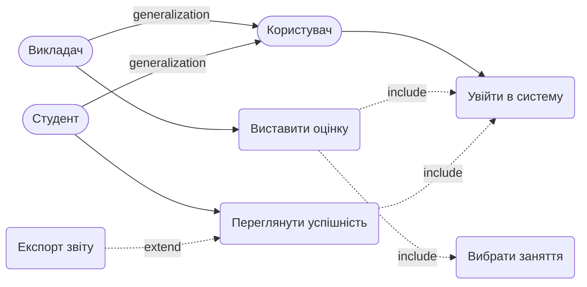

# Вимоги та Сценарії використання

## 1. Функціональні вимоги (EARS)
- **REQ-1:** WHEN Викладач ініціює виставлення оцінки, система SHALL перевірити, чи бал знаходиться в межах від 0 до 100.
- **REQ-2:** WHEN оцінка валідна, система SHALL зберегти запис GRADE у базі даних.
- **REQ-3:** IF оцінка виходить за межі діапазону (< 0 або > 100), THEN система SHALL відхилити запит із помилкою.
- **REQ-4:** WHEN Викладач оновлює існуючу оцінку за те саме заняття, система SHALL перезаписати бал у БД (без збереження історії змін, згідно з ER-моделлю).

## 2. Нефункціональні вимоги (NFR)
- **NFR-1 (Пристрої):** Система SHALL підтримувати роботу з пристроїв (iOS 15+, Android 10+) та браузерів (Chrome 115+, Safari 16+).
- **NFR-2 (Навантаження):** Система SHALL витримувати до 1000 одночасних користувачів. При перевищенні межі нові запити SHALL ставитися в чергу.
- **NFR-3 (Продуктивність):** Час відгуку SHALL бути < 1.5 секунди (95-й перцентиль, вимірюється на сервері при навантаженні 1000 користувачів).
- **NFR-4 (Безпека):** Система SHALL гарантувати, що Студент має доступ виключно до власних оцінок.

## 3. Межі системи (Поза обсягом)
- Блокування акаунтів.
- Експорт аналітичних звітів у PDF.
- Email-сервіс (не є актором).

## 4. Gherkin-сценарії (UC: Виставити оцінку)
**Feature: Виставити оцінку**

    # Сценарій 1: Успішне виставлення оцінки
    Scenario: Викладач успішно додає валідну оцінку
      Given викладач авторизований та вибрав заняття
      When викладач вводить бал "95" для студента
      Then система зберігає запис GRADE

    # Сценарій 2: Оцінка поза допустимим діапазоном
    Scenario: Викладач вводить некоректний бал
      Given викладач авторизований та вибрав заняття
      When викладач вводить бал "150" для студента
      Then система відхиляє збереження
      And показує помилку "Оцінка має бути від 0 до 100"

    # Сценарій 3: Повторне виставлення (зміна оцінки)
    Scenario: Викладач змінює вже виставлену оцінку
      Given студент вже має оцінку "90" за поточне заняття
      When викладач вводить новий бал "95"
      Then система перезаписує бал на "95"

## 5. Use Case Діаграма (Mermaid)

## 6. Матриця трасування
| Вимога (EARS) | Gherkin-сценарій |
|---------------|------------------|
| REQ-1, REQ-2  | Сценарій 1 |
| REQ-1, REQ-3  | Сценарій 2 |
| REQ-4         | Сценарій 3 |

**Непокриті UC та обґрунтування:**
- *Увійти в систему, Вибрати заняття, Переглянути успішність* — залишені на рівні діаграми, деталізуватимуться у наступних спринтах.
- *Експорт звіту* — знаходиться поза обсягом MVP (винесено в розділ 3).